# THE BACKROOMS

### ▶ [Play it in your browser](https://domcampese.github.io/backrooms-game/)

No install. Works on a phone: touch controls appear automatically.

Disclaimer: just for fun, mostly generated with Claude models

A Backrooms horror game with an infinite, procedurally generated world, written
in C++ and running natively and on WebAssembly. The levels and sounds are
generated in code; an animated CC0 revolver and a few CC0 textures are
embedded at build time.

The game comes in two builds from one repository:

| build | what it is | where it runs |
|---|---|---|
| **Web** (`web/`) | the game on raylib; small, quick to load, playable from a link | any browser, phones (touch controls), and natively on desktop |
| **Unreal** (`unreal/`) | the same game in Unreal Engine 5, drawing the Web build's world with the same lighting | desktop (Mac first); see [unreal/README.md](unreal/README.md) |

Both compile the same game from `shared/`: the generator (`core`), the rules
(`sim`) and what a renderer needs from them (`port`). A seed is the same maze,
the same pickups and the same hunter in both.

## License and credits

This unofficial hobby game is released under the **MIT License**. See [LICENSE](LICENSE)
and [Credits and third-party notices](CREDITS.md) for the full terms, Backrooms
wiki author acknowledgments, and the separate licenses for adapted lore and assets.
Thanks to the Backrooms community, especially 1000dumplings and the other authors
credited there, for the shared lore behind Smilers, Partygoers, Level Fun, the Poolrooms and Almond Water.

The software is provided without warranty. Source and build instructions are
available in this repository; released builds must include access to their
corresponding source. This project is not affiliated with or endorsed by the wiki
or other Backrooms creators.

## Play it in a browser

**https://domcampese.github.io/backrooms-game/**

The game compiles to WebAssembly and runs on WebGL 2. Every push to `main`
publishes it to GitHub Pages via `.github/workflows/pages.yml`, which runs the
same `tools/web-build.sh` you would run locally.

```bash
source /path/to/emsdk/emsdk_env.sh   # emscripten on PATH
tools/web-build.sh                   # -> web/dist/index.{html,js,wasm}
cd web/dist && python3 -m http.server 8099
```

The first run compiles raylib for the browser from the tag the script pins; it
is cached in `.raylib-web/` afterwards. Both are gitignored.

The dev knobs are URL query parameters rather than environment variables:
`?seed=1337`, `?level=2`, `?pos=95,79,1.2`, `?flash=1`, `?exits=1`,
`?noblackout=1`. Pass `noblackout=1` for any screenshot: there is no
`BACKROOMS_SHOT` on the web to turn blackouts off, and a capture during a
blackout is a black frame that looks like a failed shader compile.

Records are kept in IndexedDB rather than `$HOME`, so they survive a reload but
are per-browser.

### On a phone

Touch controls appear automatically on a coarse pointer: a floating thumbstick
in the lower left (push it all the way to run), drag anywhere else to look, and
a button cluster for fire, aim, reload, jump, use, torch, item, throw, chalk
and drink. Force them on or off with `?touch=1` / `?touch=0`.

**Tap anywhere to begin**, or push the stick. The title card and the death
card both start a run on a tap of open screen, and a stick push starts one
with you already walking. Both trigger on the press, not while held, so a
thumb still on the stick when you die does not dismiss the death card.

**Sprint is a push past the ring.** The drawn edge of the thumbstick is the
line, and the ring lights up while you run. Sprint is currently unlimited: the
stamina meter is still drawn and still recovers, but nothing drains it.
(`SPRINT_DRAIN` in `updateSprint` restores the limit: it was 16 s of sprint
against 6 s to recover.)

**Look sensitivity** is set so one thumb drag across the screen turns you about
half way round (it was a quarter turn). `tools/mobile-check.mjs` checks the
resulting degrees per drag rather than the constant, since the game's own
radians per pixel are the other half of it.

**AIM is a toggle** rather than a hold: one tap raises the sights, another
lowers them, so the right thumb is free to fire. The game owns the toggle, so
anything that makes aiming impossible lowers the sights, and tapping LOAD
lowers them first (a reload cannot start while they are up).

The controls are drawn by the page, not the game. `web/src/input.h` turns them
into the same input calls the desktop build makes, so the game does not know
which it is running on.

`node tools/mobile-check.mjs` loads `web/shell.html` in Chromium at eight phone
and desktop sizes and checks that no two controls overlap, that the splash fits
or scrolls with ENTER on screen, that the canvas keeps its aspect ratio at any
size raylib gives it, and that a tap or a stick push starts a run while a
button press or a look drag does not.


## Model asset pipeline

Prepared `.glb` models use Raylib's standard model and animation loaders through
`ModelAsset`. Add models under `assets/models`; build-time packaging discovers them
automatically. See [the asset workflow and validation](docs/model-pipeline.md).

## Object realism pass

The held revolver uses a complete CC0 model by loafbrr_1, with authored textures,
normal detail, and firing/reload animation. It retains the six-shot mechanics and
fits the existing wall-clearance envelope. [Import details and screenshots](docs/revolver-import.md)
and [source/license](assets/revolver/README.md).

Wood and fabric furniture has bevelled edges. Scanned metal, wood and
upholstery textures are in the shared prop atlas; object gloss is independent
of each level's floor gloss.

The external tiles add about 45 KB compressed, are embedded in the executable,
and need no runtime downloads. [Sources and licensing](assets/materials/README.md).
Python 3 is required at build time to embed them; no additional Python libraries
are needed. See [validation](docs/object-realism-pass-two.md).

## Surface realism pass

Every floor, wall and ceiling texture is generated in code at real size, with
a height field for its relief:

- **Relief comes from a height map, not from the colour.** Each surface paints
  colour, height in millimetres and gloss together. Printed patterns on the
  wallpaper stay flat while roll seams are raised; the ceiling grid stands
  above the boards; mortar sits behind the brick face; pool grout sits below
  the tile. The old bump maps were the colour's brightness, so every printed
  pattern and stain was embossed.
- **Real dimensions.** Level 0's ceiling is 2 ft boards on a white grid, with
  each light filling a 2 x 2 bay. Pool tile is 6 inches on walls and floors, so the grout
  lines meet. The skirting is a 12 cm board (it was a 27 cm band).
- **No visible repeats.** Every texture wraps exactly; the old ones had a
  visible seam every 2-3 m. The shader also varies tone in world space so
  grime does not repeat in a grid. Each ceiling board has its own shade, and
  about one in twenty is water-stained, different on every floor.
- **Materials.** Formed concrete with plywood marks, form-tie holes, rust runs
  and a damp band at the foot; a trowelled concrete slab; loop-pile carpet; a
  patterned carpet for LEVEL FUN; a carpet with coloured shapes, fabric wall
  panels and a black board ceiling for the theater.
- **Objects.** Cartons have tape and a barcoded label. The almond water can
  and tape deck are redrawn at 3-4x the resolution with printed lettering.
  Outlets are duplex receptacles.
- **The revolver.** Its steel reflects an approximation of the room (the
  ceiling and its lights along the top, the walls in the level's colour, the
  floor below) instead of shading as grey plastic, and the grips are walnut.

Each surface keeps its predecessor's mean brightness, so exposure did not
change. `tools/sandbox-build.sh texdump && ./texdump out/` writes every
texture to PNG with its mean colour.

## Graphics update

The renderer uses generated, mipmapped surface-detail maps, recessed fluorescent
housings and baseboard trim. Tile grout has lower gloss than the glaze.
Flashlight haze is kept faint so lit surfaces stay readable. The revolver and
flare are 3D, with recoil, reload dip and muzzle effects; the almond water in
hand sits lower and is smaller. Model transforms also transform lighting
positions and normals, which fixed misplaced lighting on cans and tape decks.

Furniture has separate wood and fabric atlas regions, cushion seams, cabinet
handles, wardrobe panels, round lampshades, cooler bottles and leaf geometry.
Post-processing uses less grain and chromatic aberration, with 12 bloom taps
instead of 20. Chunks outside the camera are culled and opaque chunks draw
nearest first.

Chalk marks are arrows. When sprint is exhausted it waits for recovery instead
of switching between running and walking; a new run restores stamina.
Footsteps and distance records follow actual travel. Batteries can be picked up
later even when the flashlight is full.

See [validation and limitations](docs/graphics-update.md).

## The camcorder and the tape

The player carries a camcorder that records the whole run. It is never held
up. The view is drawn through a lighter version of its tape effect (see
"Camcorder view" below), and a small blinking **REC** mark sits in the top
left during play.

- **Interference.** When a hunter is near, the tape shows interference
  through walls: torn lines, a rolling tracking band and dropouts. It gets
  stronger as the hunter gets closer, and strongest in a chase. You see it
  when the tape plays back.
- **Playback on death.** When you die, the death card plays back the last four
  seconds of the tape, with the sounds from that stretch. The last second
  plays at a third of the speed and pitch, then holds on the last frame, and
  the card's text appears over it. Any key skips it after 1.6 s.

The tape is stored at 15 frames a second in one 2048-pixel texture (14 MB at
1440x850), whatever the window size. None of this reaches the sim, so traces
and replays are unchanged.

## The levels

Seven procedurally generated levels, each with its own palette, lighting,
sounds and hunter. Exits lead to the next level.

Exits can be heard. Within 64 m of one you hear a low two-tone note, two
sines 3 Hz apart, panned toward it. It grows louder as you get closer, and is
quieter with a wall in between. Exits are rare, about one in a 250 m square
on Level 0, so most of the time there is nothing to hear.

| | |
|---|---|
| 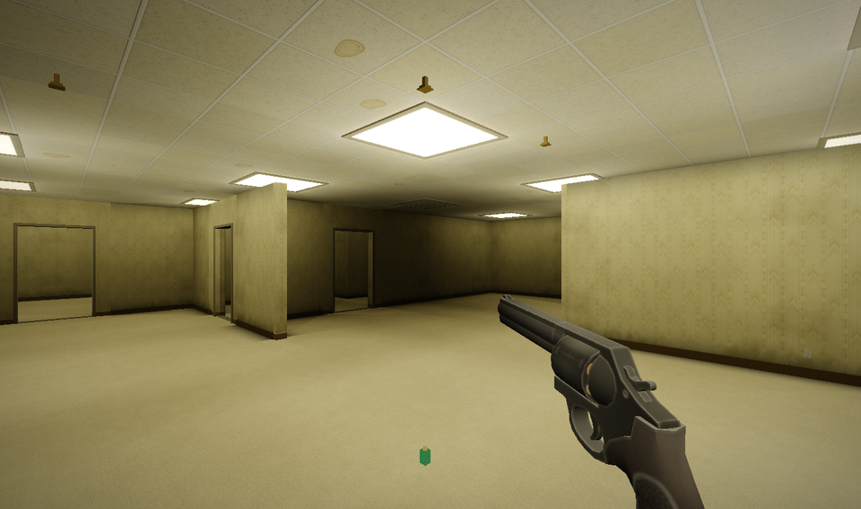 **LEVEL 0 · THRESHOLD**: empty rooms, yellow chevron wallpaper, damp carpet, an uneven grid of ceiling lights that hums, stairs up to more floors like this one, and railed openings down to others. The exits are walls you walk through. The hunter is Pirate Clark. | 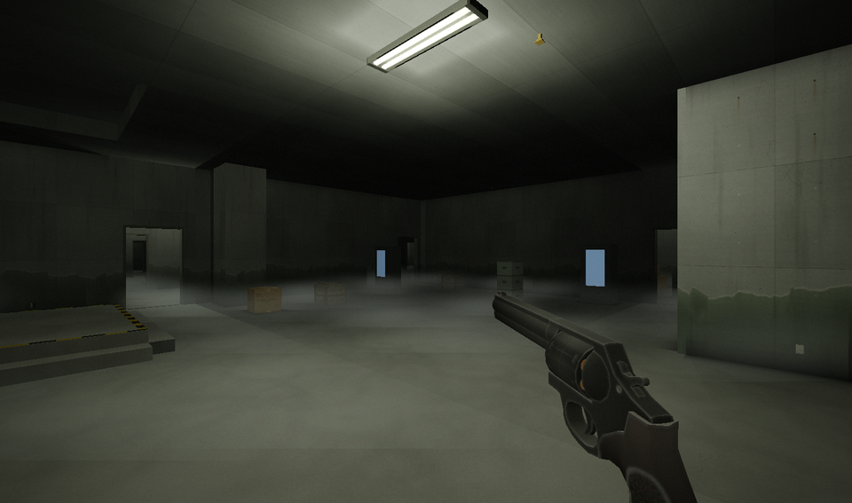 **LEVEL 1 · HABITABLE ZONE**: a concrete warehouse with dim tube lights, many of them dead, low fog on the floor, exposed rebar, supply crates that move during blackouts, and exit doors marked with symbols. The hunter is a Smiler. |
| 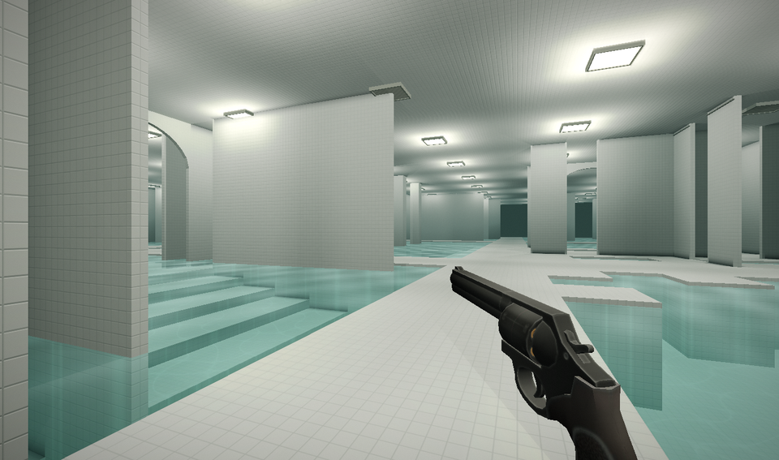 **THE POOLROOMS**: white tile and water: colonnaded halls, flooded tunnels, staircases down into deep water, and windows of white light. No hunter and no blackouts, but you can drown, and doubloons lie on the floor of the deep water. | 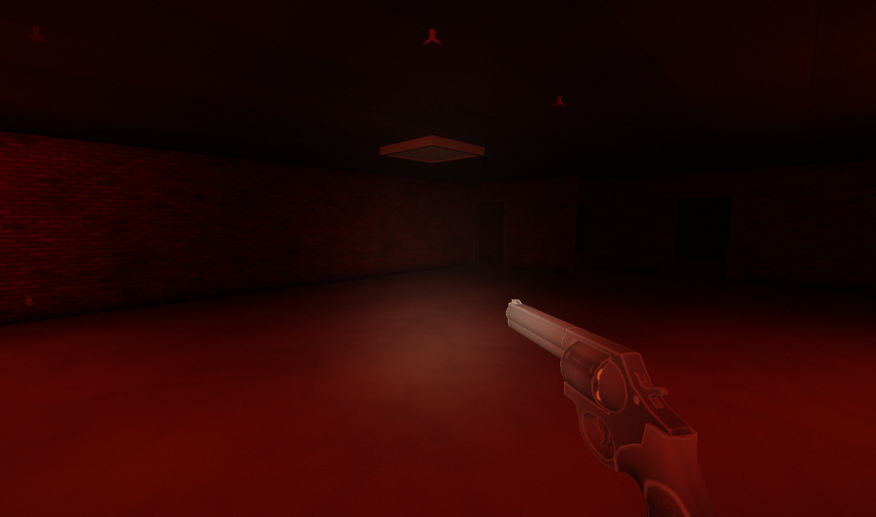 **LEVEL FUN =)**: red carpet, a black ceiling, bunting, balloons and party tables. The hunter is the Partygoer. Every 20-40 s the music stops for 6-9 s. Stand still until it starts again: if you move once the first 0.8 s are up, the Partygoer hears you and comes for you. While the music plays it covers your footsteps, so the Partygoer hears them at 60% of the usual distance. |
| 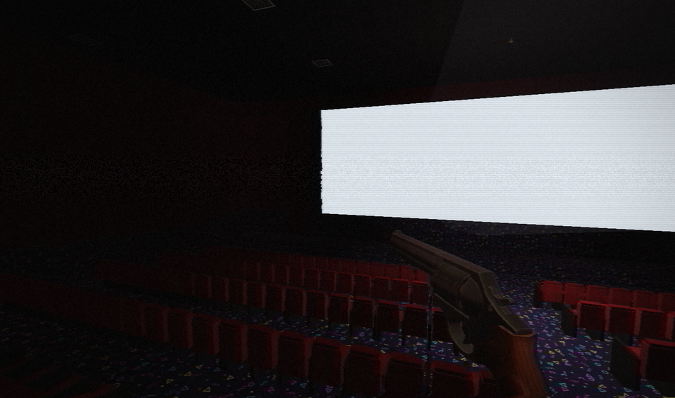 **THE THEATER**: a cinema that does not end. Lobbies are two halls with film posters, a concession counter with a roped queue, and drink and snack machines (a snack costs two doubloons and heals you). Dark auditoriums have stepped rows of red seats facing a screen that is still showing a film; the screen is the only light in the room. Slip past either end of the screen to reach backstage, where a tape and loose doubloons lie among the cartons. The Usher, a faceless figure in a burgundy uniform, walks the aisles with a torch: if its beam holds you, it whistles and the Smiler comes running. Crouch still between the rows to hide from both. The film's soundtrack fills the auditorium you are in: during a loud scene the hunter hears your footsteps at half the distance, and during a dark, quiet scene at 1.4 times. The HUD says which. It is the second level: Level 0's exits lead here. | 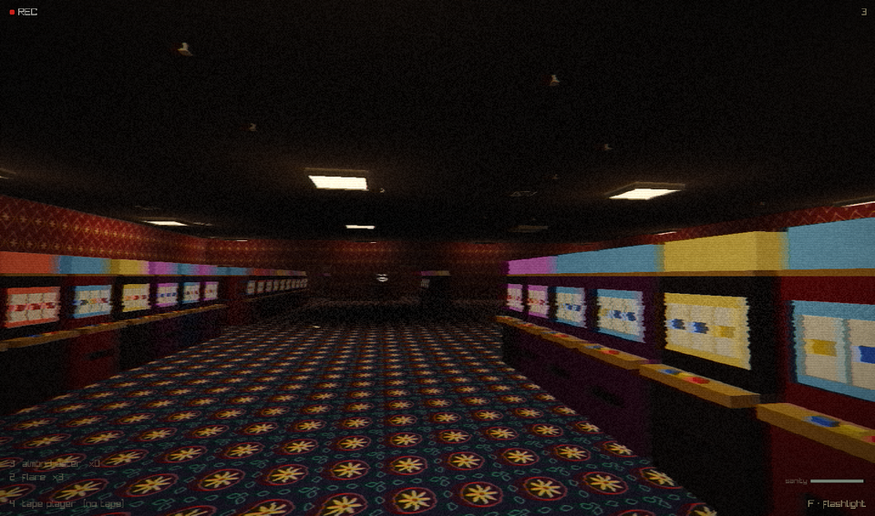 **THE CASINO**: a gaming floor that does not end. Gold damask walls, busy carpet, banks of lit slot machines back to back, and card tables with the chips still on them. A slot machine takes one doubloon a pull: it can pay two doubloons, a can of almond water, or an eight-doubloon jackpot, and on average it pays back a little less than you put in. The reels are loud while they turn, and the hunter can hear them. A jackpot rings bells that carry 40 m and bring the Smiler straight to you. Crouch beside a bank of machines to hide. Somewhere on the floor a gold pack of cigarettes hangs in a column of light, like the revolver. Press 6 to take one out and click to light it; each click is a drag that steadies your nerves, but one drag in four ends in a cough the hunter can hear, and a lit ember means he can see you in the dark. They only light in the casino. It is the fourth level: Level 94's exits lead here, and its exits lead to Level 1. |
| 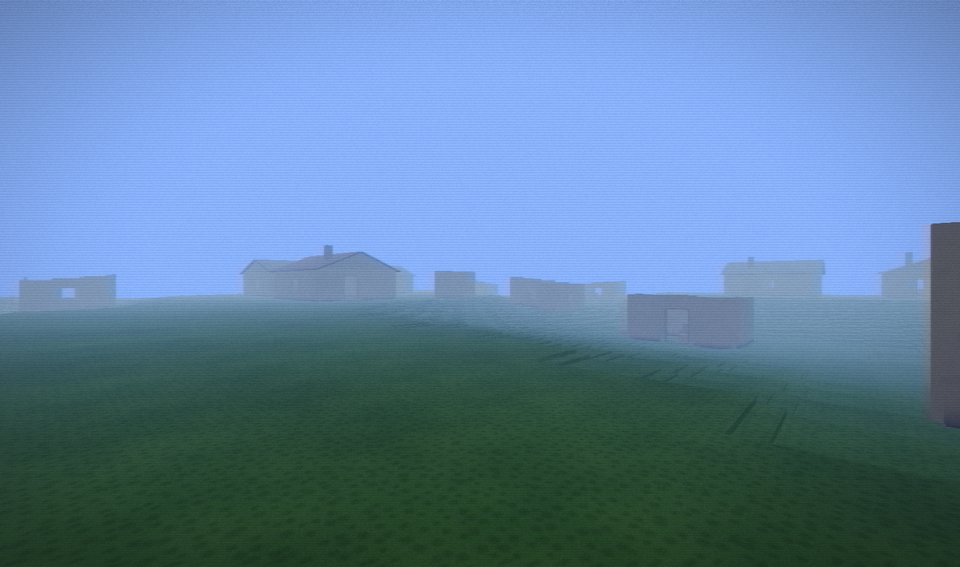 **LEVEL 94 · MOTION**: grass hills under an open sky, built like a stop-motion set: green clay grass pressed with thumbprints, and towns of pastel clapboard houses (pink, mint, sky blue, butter yellow, lavender, peach) on the level hilltops, with shutters, flower boxes, a canopy over the door and a plank floor inside. Houses are laid out differently inside: one open room, a front room with a bedroom behind it, a front room with two back rooms, or a room with a small back room in the corner. Some houses have a second floor: climb the stairwell to a bedroom, a sitting room or an attic, with windows over the hills. On the slopes stand pieces of houses with nothing round them: a wall with a couch in front of it, or a room with no roof. By day nothing hunts and the sun crosses the sky. About a minute after you arrive it goes down, the moon comes up, and for about a minute and a half the hills are dark; then it comes round again every four minutes. At night the Animations come out: tall clay cartoons with mismatched staring eyes and a grin full of teeth, which move one jerky pose at a time with the click of a camera's shutter and laugh when they see you. Get inside a house: they will not come in and cannot find you there, though they knock. In the dark they see you only within 9 m unless your flashlight is on. Lie down in a bed (E) to sleep until morning, healed, if nothing is hunting you. The hills roll in smooth slopes down into valleys 4 m deep, and here and there on a hilltop an old almond water truck is parked with its hatch open and nobody inside; there is a can left on its counter (E). The exits are glowing doors in the back walls of houses. It is the third level: the theater's exits lead here, and its exits lead to the casino. | |

All hunters use the same rules: look at one for about 1.6 s, or let it get
within 8 m of you in view, and it chases you.

<p align="center">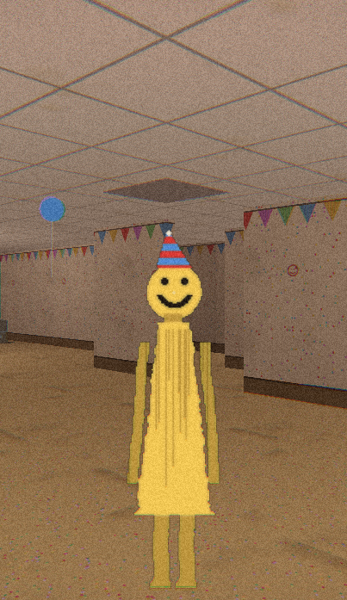</p>

## Build & run

Running the Web build natively on desktop needs [raylib](https://www.raylib.com)
5.x (`brew install raylib` on macOS; any distro package or pkg-config install
works on Linux).

```sh
make run
```

## Code layout

| path | contents |
|---|---|
| `shared/core/` | the infinite maze: generation, storeys, collision, line of sight, pathfinding, chunk layout. No engine |
| `shared/sim/` | the rules (`Sim`): the player, weapons, pickups, the hunter, levels, blackouts. No engine |
| `shared/port/` | what any renderer needs from the sim: the camera, the greybox, items held and loose, sprite poses, the sound mix |
| `web/src/` | the Web build: window, input, mesher, textures, shaders, rendering and audio on raylib |
| `web/shell.html` | the browser page around the WebAssembly build, with the touch controls |
| `unreal/` | the Unreal build: a project and one plugin that compiles `shared/` |
| `tools/` | build scripts, the contract and replay checks, mapdump, texdump, captures |
| `tests/` | the goldens and recorded traces both builds are checked against |

AGENTS.md has the module map file by file.

## How it works

- **Infinite world.** Chunks of 32 m are generated from the world seed (wall
  runs with doorways, rooms, pillars, props) and meshed. They load around you
  and unload behind you.
- **Storeys.** Level 0 is a stack of floors 4.32 m apart, joined by enclosed
  stairwells, straight flights through openings in the ceiling, and
  double-height halls with railings on the floor above. Each floor is its own
  maze. The floor you stand on is always at y = 0, so collision, pathfinding,
  line of sight and shadows stay two-dimensional; other floors are drawn
  offset by the storey height, and only through an opening you can see.
  Crossing the middle of a flight moves the world one storey. Stairs,
  openings and railings are computed from the chunk and the two floors they
  join, so both floors build the same stairwell independently. Light from the
  floor above comes down through openings, stairwells have a light on the
  half landing, the hunter follows you up stairs, and falling over a railing
  hurts.
- **Lighting.** Ceiling lights sit on a grid (4 m on Level 0, 12 m on Level 1,
  8 m elsewhere), so the fragment shader computes the 9 nearest lights from
  their positions with no light data. A hash decides which tubes are dead and
  which flicker. Blackouts turn off every light on the level for a while.
- **Light stops at walls.** The ceiling lights, the flashlight, flares and the
  muzzle flash are all blocked by walls. Each floor is a 2D floorplan extruded
  to the ceiling, so whether a light reaches a point is a 2D question. The
  cells around you are packed into a 64 x 64 byte texture (one bit per wall
  edge, one for pillars), and the fragment shader walks a line across it
  toward each light, testing the wall edges it crosses. There are no shadow
  maps and no extra passes. Doorways and window glass are not in the grid, so
  light passes through them.
- **Soft shadows.** A ceiling panel is about a metre wide, so each is traced
  from both ends and the two results are averaged, which softens shadow
  edges. A wall blocks the direct light only; a fixed fraction still reaches
  the far side to stand in for bounced light, so rooms next to lit ones are
  not black.
- **The hunter casts a shadow** when lit by the flashlight or a flare. It is
  treated as a body rather than a column, so a beam that passes over its head
  still lights the ceiling behind it.
- **Audio.** One synthesized stream: a 120 Hz hum with harmonics, room tone,
  and a growl that gets louder when a hunter is near. Footsteps and other
  one-shots are synthesized samples.
- **The hum.** The Backrooms wiki describes the hum as louder than ordinary
  fluorescent lights and as causing headaches, so it is mixed prominently on
  Level 0. Two tones 0.6 Hz apart beat about twice a second, and standing
  under a working light makes it louder. In a blackout the hum stops and a
  thin high tone remains.
- **Reverb.** A Schroeder reverb on the ambience, with decay and wet level set
  from the average open distance around you, so a corridor and a warehouse
  hall sound different. The left and right channels use different all-pass
  chains, which gives the stream stereo width.
- **Sound through walls.** Every positional one-shot has a second version for
  when there is a wall in the way: low-passed, with a softer attack, quieter,
  and falling off faster with distance. Which one plays is decided by line of
  sight when it plays.
- **Props.** Carton stacks, filing cabinets, folding tables and fallen ceiling
  tiles, placed by the generator. All are solid.
- **Pirate Clark** (Level 0): tricorn hat, one glowing eye, a hook and a peg
  leg.
- **The Smiler** (Levels 1 and 3, and the theater), from the
  [Backrooms wiki](https://backrooms.fandom.com/wiki/Entity_3): a dark shape
  with two glowing eyes and a glowing grin, drawn unlit so it shows in dark
  corridors. Lights go out around it.
- **Health.** A landed lunge takes 0.6 of your health, so you can
  survive one; a second before you recover kills you. Health starts coming
  back after 6 s without being hit and is full about 10 s later.
- **Walk cycle.** The hunter's six-frame walk is generated by the same code
  that draws it, and is driven by the distance it has covered, so the frame
  where a foot lands matches the footstep sound. It bobs and leans forward
  when chasing and further when lunging.
- **Turning to look.** A second row of the sprite sheet has the hunter facing
  you. It is used while the same timer that starts a chase is running, so it
  shows just before it chases.
- **Where it appears.** About a third of the time the hunter appears close to
  you and out of sight: around the corner you are heading for, or at the far
  end of a corridor you are about to walk down. The rest of the time it
  appears in the distance.
- **Death.** When you die, a card shows the level, the time, the metres walked
  and what killed you, then the title screen returns. Your deepest level and
  longest run are kept with the other records.
- **The lunge.** The hunter has to start a lunge from within 2.5 m. The lunge
  plays a sound and lasts 0.6 s, and only a lunge in progress can hit you.
  Sprint out of reach and it has to reposition.
- **Losing the hunter.** In a chase the hunter goes straight for you while it
  can see you. Once a wall is between you, it does not know where you are. It
  walks to the last place it saw or heard you, then checks each piece of
  cover within 8 m of it, nearest first, stopping 1 s at each. It gives up
  after 10 s without seeing or hearing you.
- **Shadow.** In a chase the hunter sees you from 30 m in a lit spot, but only
  from 9 m where no working ceiling light reaches you, unless your flashlight
  is on. The HUD says "[ in shadow ]" while a hunter is out and you are in
  such a spot. About a fifth of Level 0 is in shadow, around dead tubes, and
  most of Level 1 and the theater's auditoriums. A blackout puts everything in
  shadow. It hears walking
  within 11 m, sprinting within 20 m, the tape player, a flare being lit and a
  shot.
- **Doors.** Face a doorway and press E (USE on touch) to shut or open it. A
  shut door blocks the hunter's sight and the light. The hunter can open one:
  it stops, knocks on it every 0.45 s,
  and opens it after 1.6 s. Shutting or opening a door can be heard 14 m
  away.
- **Darkness around the hunter.** Ceiling lights go dark in a radius around
  the hunter and the dark area moves with it: partly while it stalks, fully
  while it chases. The flashlight and flares are not affected, so they show
  where it is.

  <p align="center">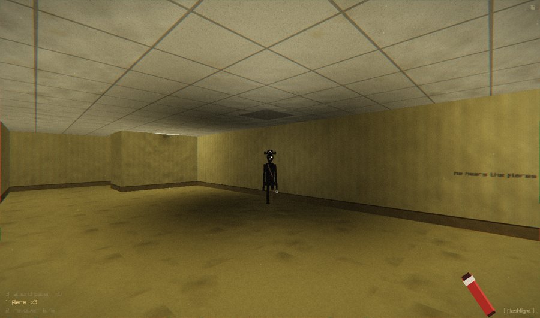</p>
- **Hiding.** Crouch (CTRL) still next to cover (a couch, filing cabinet,
  desk, shelving, party table, carton stack, theater seats or a
  counter) and the hunter cannot see you from a distance. If it comes within
  1.4 m with a clear line to you, which it does when it checks your cover, it
  finds you: you hear it, and you cannot hide again for 2 s. Hide away from
  where it lost you, more than 8 m off, and it does not check there.
- **Flares.** Throw one (Q, or left click when selected). It bounces off
  walls and burns for 9 s as a point light in the shader. The hunter will not
  come within 6 m of a burning flare and runs from one. You carry up to three
  and find more over time. Water puts them out.
- **Revolver.** A run starts empty-handed (1 puts whatever you hold away).
  The revolver is found, not carried: about one empty floor cell in 2,000
  holds one, roughly one every ten chunks, turning in the air in a column of
  gold light. Walk into it to take it. Then select it with 5 or the mouse
  wheel. Hold right mouse to aim.
  Six rounds; R reloads once the sights are lowered. A hit slows the hunter
  briefly but does not stop it, and it now knows where you are. Three hits
  put it down for a couple of minutes. Fire is the only thing that makes it
  run.
- **Flashlight battery.** The flashlight lasts about 100 s on a full battery,
  flickers when the battery is low, and switches off when it runs out.
  Batteries can be found in the world.
- **Sanity.** A meter that drains while you are on a level: about 9 minutes
  from full on Level 0, 4 in LEVEL FUN. It drains faster in the dark or while
  a hunter is after you, and slower while you are hidden. As it drops,
  whispers come more often and you hear your pulse. Below a tenth, the view
  narrows and the whispers and pulse get louder. At zero the run ends. Almond
  water and the tape player restore it.
- **Shifting walls.** Below a tenth of your sanity, doorways you have passed
  through can become walls. Only doorways you cannot currently see change, and
  never a room's last way out.
- **Almond water.** Press 3 to drink. The can comes up for three swallows,
  during which you cannot use your hands. It restores about a third of your
  sanity and your stamina. Cans are found on the floor and on tables, desks,
  and cabinets.
- **Cassette tapes.** Rarer pickups, each with a line of text. The tape player
  uses them.
- **The tape player** (4). Load a tape and press play: a synthesized voice
  with tape noise plays, and while you can hear it your sanity slowly goes up
  instead of down.

  A playing tape is loud: the hunter hears it from 32 m. You can set the deck
  down while it plays and walk away, and the hunter goes to the deck instead of
  you. The deck only restores sanity within about 14 m, less through walls,
  which is well inside the range the hunter hears it from. The record lamp blinks while it plays; pick
  it up again with E.
- **Terrain.** Level 0 has sunken areas, Level 1 has raised loading docks, and
  the pools have steps down into the water. You can jump onto most furniture
  and walk across it.
- **Furniture.** Couches, filing cabinets, shelving and party tables, all solid and most of them climbable. Level 0 has none: following
  the wiki's description of empty rooms, it has only carton stacks and fallen
  ceiling tiles.
- **Level 0 details.** Yellow chevron wallpaper (from the 2002 photograph),
  drop-ceiling lights with a fifth of them dead and the rest uneven, carpet
  with rotten patches, and a hum that builds a migraine effect which stays
  for a while after you leave. White doors lead on. Some areas have 3, 5 or 7 stacked floors around a shared opening.
- **Level 1 details.** Bare concrete with a damp line at the bottom of the
  walls and exposed rebar, low fog, and twin-tube lights with three in ten
  dead. Supply crates hold something useful or junk, and move to new places
  after each blackout. Exits are steel doors with a symbol painted on each.
  The lift doors never open.
- **The Manila Room.** A rare 8 m square room on Level 0 with manila
  wallpaper, wooden floorboards, a door on each wall, a table with two chairs
  under a chandelier, almond water in the cupboard, and notes to read (E). The
  hum stops inside, your sanity recovers, and the notes mark a way out with
  chalk.
- **Atriums.** Level 0 sometimes has a sunken hall: the floor steps down in
  0.5 m rings to 2.5 m below the rest, with stairs at every edge. Level 1's
  loading docks can be two tiers high.
- **Pipes on Level 1.** Pipes run along the corridors under the
  ceiling, with collars every few metres. Each corridor either has a pipe
  along its whole length or none.
- **Exits.** Exit doors are set into wall runs. Each takes you to the next
  level.
- **Escaping.** Hunters drop doubloons when you put them down. With 12
  doubloons, exit doors turn green, and walking through one ends the
  run as an escape, which is timed and recorded. Doubloons also buy almond
  water from vending machines, so spending them delays escaping. In the
  casino you can gamble them on the slot machines: a jackpot gets you most
  of the way out, but the bells bring the hunter.

  <p align="center">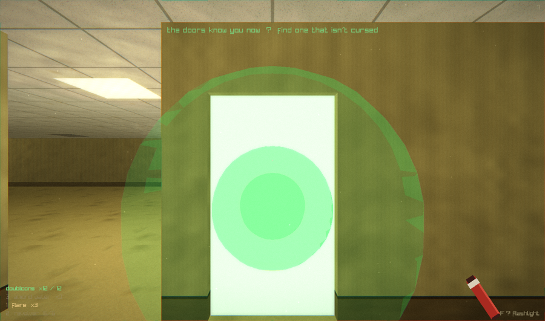 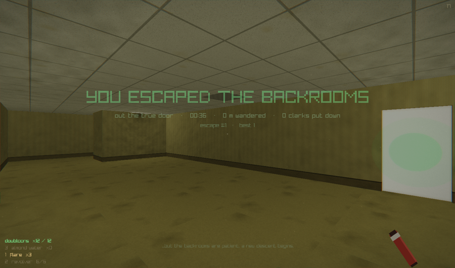</p>
- **LEVEL FUN details.** Red carpet with confetti in it, a black ceiling,
  bunting, crayon smileys, balloons on the ceiling, streamers, wrapped
  presents, and party tables with cups, a cake and balloons tied to them. The
  candles stay lit during blackouts. A recorded party loop plays slowed down
  and out of tune.

  <p align="center">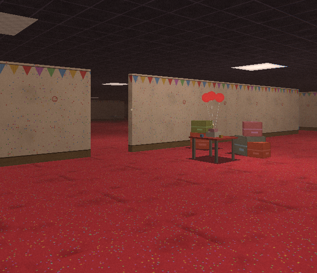</p>
- **Surface relief.** Generated, mipmapped detail maps follow the material
  UVs. Tile joints are recessed and less glossy; smooth objects have no relief.
- **Baked ambient occlusion.** Contact shadows are baked into each chunk's
  geometry as gradient strips: along the base and top of each wall, up the
  skirting, and around each pillar. They cost nothing per frame.
- **Post-processing.** Bloom on the lights, a filmic tone curve with a slight
  contrast and saturation lift, vignette, chromatic aberration and a faint
  brightness flicker at mains frequency. Some of these increase with fear.
- **Camcorder view.** The view always has a lighter version of the camcorder
  tape effect: colour smeared to the right, slightly soft detail, noise,
  faint scanlines, a slow tracking band, a skewed bottom edge and occasional
  dropouts. Fear moves it toward the full tape effect. There is no toggle.
- **Title screen.** A camera moves slowly through a hall behind the title,
  the "press any key" prompt, your best run and the controls. Any key or
  click starts a run on Level 0.

## Smaller details

- **The Partygoer** (LEVEL FUN): pale yellow, a painted smile and a striped
  party hat. It uses the same rules as the other hunters.
- **Balloons.** Shooting a balloon in LEVEL FUN pops it with a sound and a
  burst of confetti. Hitting one balloon in a bunch tied to a table pops the
  whole bunch.

  <p align="center">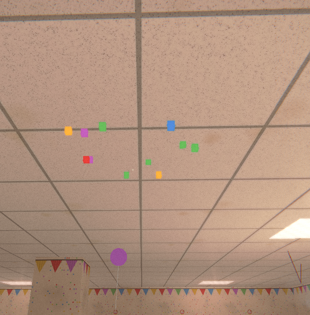</p>
- **Footsteps per floor.** Separate synthesized clips for carpet (Level 0,
  LEVEL FUN and the theater), concrete (Level 1), tile (Level 2) and wood
  (the Manila Room).
- **Distant sounds.** Every 35-85 s (sooner at low sanity) a muffled sound
  plays from a random direction: a door closing on Level 0, a metal clang on
  Level 1, a balloon pop on LEVEL FUN, a low boom in
  the theater. None on Level 2.
- **Hunter footsteps.** In a chase you hear the hunter's footsteps, panned to
  its direction and quieter with distance, including through walls.
- **Locked doors.** About one chunk in three has a locked door, with its key
  within a few metres on the side you can reach. Behind it is either a small
  room or a shortcut. E (USE on touch) unlocks it for good.
- **Rotten floor.** Level 0 has rare dark patches of carpet. Stand on one for
  too long and you fall through to Level 1.
- **Wall writing.** Some walls have handwritten messages ("NO CLIP", "day
  407", "the exit lies", "he hears the flares").
- **Muzzle smoke** rises from the revolver after each shot.
- **Camera movement.** The view tilts slightly when you strafe and dips when
  you land.

## The Mannequin

On Levels 0 and 1, the Mannequin can appear after two and a half minutes.
Keep its body centred in your view to freeze it. Turn away and it pursues
you, changing pose between sightings. The camera records continuously.

Flares within five metres hold it back. Bullets stagger it briefly but do
not kill it. Break its line of sight and get more than 24 metres away for
eight seconds to escape. The usual hunter stays out of this encounter.
The Poolrooms and Manila Room remain safe.

## Controls

| key | action |
|---|---|
| WASD | walk |
| mouse | look |
| SHIFT or double-tap W | sprint |
| CTRL | crouch |
| C (hold) | squeeze through narrow gaps; release in open space to straighten up |
| SPACE | jump / hold to stay up while swimming (let go to dive) |
| F / L | flashlight |
| hold right mouse | revolver iron sights (release to lower; no reload while aiming) |
| 1 / 2 / 4 / 5 / wheel | select item (empty hands / flare / tape player / revolver, once found) |
| left click | use selected weapon |
| Q | throw flare (always) |
| R | reload revolver |
| 3 | drink almond water |
| 4 | tape player (click to play a tape; click again to set it down running) |
| M | chalk a directional floor arrow |
| 6 | take out a cigarette (once you have the casino's gold pack, in the casino); click lights it, then takes a drag |
| E | shut or open a door; unlock a locked door; buy from a vending machine; pull a slot machine's handle; sleep in a bed (Level 94, at night); pick up the tape player; read the Manila Room's notes; open a crate |
| F11 | borderless fullscreen |
| P | pause |
| ESC / click | release / capture mouse |
| F3 | debug HUD |

## Dev/testing knobs

With the F3 debug HUD open, dev hotkeys are live: `B` force blackout,
`E` spawn the level's hunter stalking ahead, `C` force a chase, `H` despawn it,
`G` refill flares and ammo, `N` jump to the next level by number (0 to 4),
`PageUp`/`PageDown` up or down a storey where you stand (Level 0).

- `BACKROOMS_SHOT=out.png`: run headlessly, save a screenshot, exit.
- `BACKROOMS_SHOTFRAME=n`: which frame that screenshot is taken on (default 600).
  Lower it to sweep the game quickly; the software renderer is slow.
- `BACKROOMS_MENU=1`: hold on the title screen (skips the auto-start; visual testing).
- `BACKROOMS_EXITS=1`: exit doors everywhere (visual testing).
- `BACKROOMS_MANILA=1`: a Manila Room in the chunk east of spawn, centred at x 48, z 16 (visual testing).
- `BACKROOMS_RECORD=path`: record every call on the sim to a trace; `./replay path` replays it without the game (shared/sim/trace.h).
- `BACKROOMS_CHASE=1`: the hunter the headless capture spawns on frame 300 gives chase, which is how a capture reaches the death card's tape.
- `BACKROOMS_POS="x,z,yaw[,pitch]"`: start at a specific spot and heading, optionally looking up (+) or down (-) by `pitch` radians (visual testing).
- `BACKROOMS_LEVEL=n`: start on level n, 0 to 6 (visual testing).
- `BACKROOMS_NIGHT=1`: on Level 94, skip to dusk on frame 20 (F3's B); night falls 7 s later.
- `BACKROOMS_SEED=n`: fix the world seed (repeatable maze).
- `BACKROOMS_STOREY=n`: start on storey n of Level 0 (0 is the floor you wake on).
- `BACKROOMS_NOBLACKOUT=1`: never schedule a blackout. Defaults to on whenever
  `BACKROOMS_SHOT` is set, because blackouts run on the wall clock and a headless
  capture is slow enough to land inside one; pass `0` to capture a blackout
  deliberately. The F3 `B` key still forces one either way.

### Native regression tools

`tools/shot.sh` and `tools/sweep.sh` run natively on macOS and use Xvfb on Linux.
Capture logs are retained and shader failures stop the scripts.

- `BACKROOMS_CLEAN=1`: omit gameplay HUD and introductory fade in captures.
- `BACKROOMS_TIME=4`: fix rendering time (does not freeze gameplay or menu movement).
- `BACKROOMS_BENCH=1`: disable vsync and report mean, median and p95 frame times
  after 60 warmup frames; skip the forced screenshot-test enemy spawn.
- `BACKROOMS_BIN=/absolute/path`: select a binary for `tools/shot.sh`.

`make regression` checks sprint recovery, restart reset, battery retention, that
a doorway's jambs and a locked door actually stop a body, and that neighbouring
storeys agree about every stair and opening (a flight climbed and descended by the
real mover, Clark following, a fall through an atrium), then
captures held-item, navigation and storey views in `shots/regression`. It needs a display.
`tools/bench.sh /absolute/baseline /absolute/new 2 3` interleaves runs and retains logs;
legacy binaries report total runtime only. Automated captures do not save player records.

Revolver rounds travel through the world and stop at the first surface or target, with a brief trail and impact debris. On touch devices, hold **SQUEEZE** while moving the stick to pass through narrow gaps.

### Poolrooms and swimming

The Poolrooms are based on [Level 37: Sublimity](https://backrooms-wiki.wikidot.com/level-37): white tile, blue-green water, tiled arches, large colonnaded halls, flooded tunnels, underwater staircases, and windows of white light. No hunter spawns here, and sanity slowly recovers.

Pools have shallow shelves and deep centres. In deep water, hold **SPACE** to swim up and stay at the surface; let go and you sink, which is how you dive. **SHIFT** swims faster. On touch screens hold **JUMP**. Swim toward a shelf at the surface to climb out; submerged steps are solid.

With your head under water a breath bar appears above the sprint bar. It empties in 18 s and refills in 3 s at the surface. Empty, you lose about a quarter of your health each second until you surface, so staying under ends the run in about 4 s. Surfacing short of breath plays a gasp. The floors of the deepest water (2.4 m and below) hold doubloons, about one in 23 cells, and an occasional carton of almond water. They are out of reach from the surface; dive to the floor to pick them up.

See [the Poolrooms implementation and visual checks](docs/poolrooms.md).
