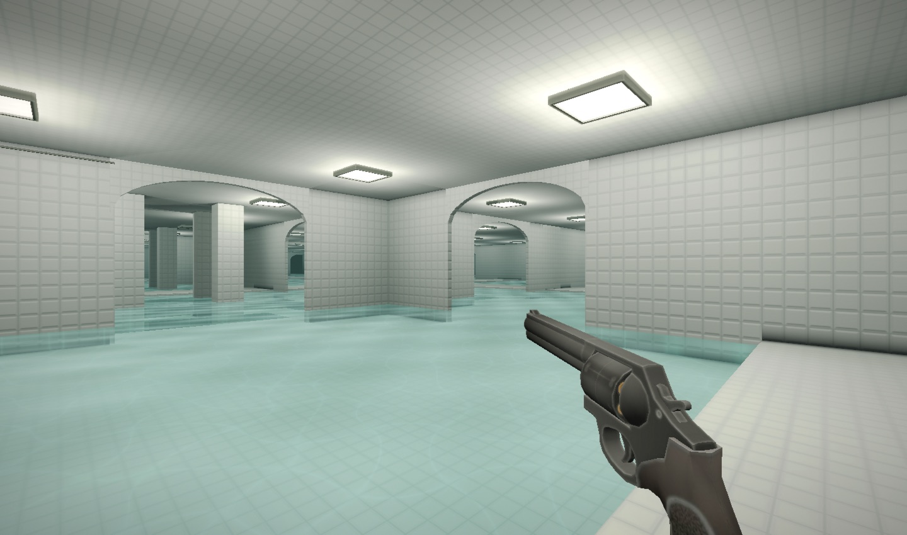
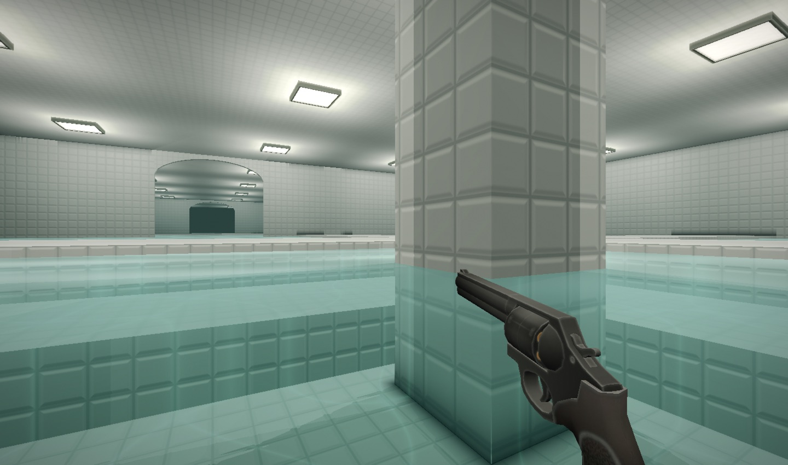
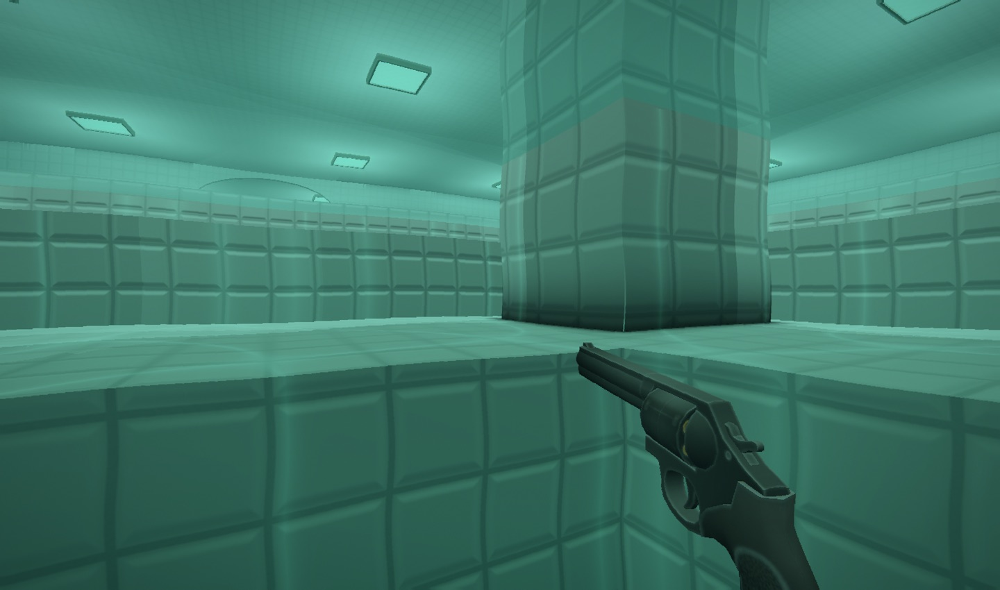

# Poolrooms: Sublimity and swimming

The visual reference is [Wikidot's Level 37, “Sublimity”](https://backrooms-wiki.wikidot.com/level-37), by egglord: white ceramic tile, blue-green water and large bathing halls. Reference images are credited there to AnarkyMusic under CC BY-SA 4.0; they were used for research, not bundled as game assets. The geometry, tile textures and water effects here remain procedural.

## In-game views







These are native game captures, not concept images.

## Design and controls

The level is built from the lore's own vocabulary rather than one repeated room. About one chunk in four is a single oversized hall: one basin under a colonnade, pillars standing in the deep water. The rest keep a cross of seven-metre tiled arches, and each quarter behind them is one of:

- **baths**: wading shelves stepping down to 2.8-metre-deep floors, some with a column grove or a tiled island;
- **flooded tunnels**: a braided maze of one-cell tiled corridors, either wading depth or fully submerged passages you swim;
- **submerged staircases**: a stairwell of real 0.4-metre treads descending into deep water;
- **window galleries**: dry halls with rows of windows of white light, around a small deep pool;
- **stepping stones**: dry tiled platforms standing in deep water;
- **private baths**: small tiled rooms, each with its own deep tub.

A dry walkway runs round every chunk, so the pieces always connect, and openings are plain gaps in the tile rather than door frames. The arrival landing is dry. No hunter or whispers spawn here, sanity slowly recovers, and there are no blackouts.

Deep water uses damped buoyancy and water drag. Hold SPACE/JUMP to rise and float at the surface; release it to sink, which is the dive. SHIFT swims faster. Surface swimmers climb onto shelves with eased camera motion; submerged swimmers are stopped by risers. Breath lasts 18 s under water and refills in 3 s at the surface; empty, the player loses about a quarter of their health a second (AGENTS.md, "Breath and sunken loot in the Poolrooms"). Doubloons and almond water lie on floors 2.4 m deep or more, in reach only after a dive. Underwater tint and subtle distortion distinguish diving, and slow stroke sounds replace footsteps while afloat.

## Verification

`make regression` checks stable floating at 30, 60 and 144 updates per second, diving, resurfacing, bottom bounds, leaving water, submerged risers, assisted climbs, full-height wall collision, entity suppression and sanity recovery. It also captures surface and underwater views, and finds and captures a window gallery, a submerged staircase and a flooded tunnel (`pool-windows.png`, `pool-stairs.png`, `pool-tunnel.png`), failing if any room type is missing or the level stops being mostly water.

`tools/sweep.sh` checks all six levels and the menu for shader errors and exposure. Inspect its images plus a separate pool-hall capture and flashlight capture.

Generator sample: Level 2, seeds 1337, 7 and 99, visit 1, 129 × 129 cells each: 100% reachable, no disconnected pockets, no collision-buffer overflows (worst 12 of 48 boxes), about 64% of cells water.

```sh
tools/shot.sh pool-hall.png BACKROOMS_SEED=1337 BACKROOMS_LEVEL=2 \
    BACKROOMS_POS=65,69,0.8 BACKROOMS_CLEAN=1 BACKROOMS_TIME=4 BACKROOMS_SHOTFRAME=150
```
